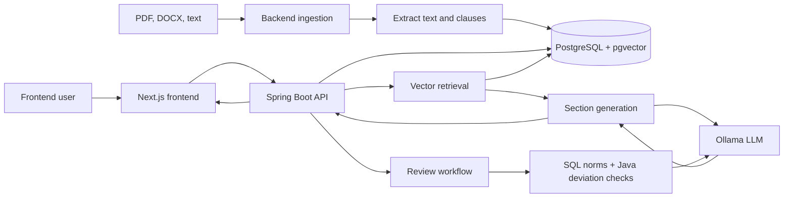

# CDC RAG

## What it is

CDC RAG is an on-premise retrieval-augmented generation platform for creating and reviewing French technical specification documents (*cahiers des charges*). It combines document search, section-based generation, and a review workflow that compares extracted contract values with historical norms. The project was built during a summer traineeship as a technical training exercise.

## Architecture overview

The Spring Boot backend handles ingestion, document parsing, embeddings, retrieval, generation, review, and exports. PostgreSQL stores documents, extracted values, and vectors. Ollama is called by the backend for text generation; the Next.js frontend calls the backend through a development/server-side API rewrite. Generation and review run asynchronously and expose status for polling.



## Stack

- Java 21 and Spring Boot 3.4.1, using JDBC and hand-written SQL
- PostgreSQL with pgvector, 384-dimensional vectors, cosine distance, and an HNSW index
- DJL with the `intfloat/multilingual-e5-small` embedding model
- Ollama with `qwen2.5:7b` for text generation
- Apache POI for DOCX processing and export; PDFBox for PDF text extraction; Flying Saucer/OpenPDF for PDF export
- Next.js, TypeScript, Tailwind CSS, and shadcn/ui
- Python scripts in `tools/` for offline corpus generation, rendering, and evaluation only

## Design choices and context

**On-premise processing.** Documents and models are intended to remain on infrastructure controlled by the operator. The backend runs embeddings locally and sends generation requests to configured Ollama instances rather than a hosted model API.

**No Python application runtime.** This was a project constraint. Runtime document handling, embeddings, retrieval, generation, and review are implemented in Java; Python is limited to offline corpus and evaluation utilities in `tools/`.

**PostgreSQL and pgvector.** Keeping vectors in PostgreSQL uses the project's existing relational data store and allows vector retrieval alongside document metadata and extracted values. The schema uses pgvector cosine distance and an HNSW index. The repository does not include a reproducible benchmark report comparing pgvector with other vector databases or simpler retrieval approaches, so comparative performance claims are not made here.

**Generation model.** The recorded evaluation rejected larger alternatives that exceeded the available read timeout and a smaller model that fabricated details. `qwen2.5:7b` was retained with a low temperature; generation quality and speed remain hardware-dependent.

**Deterministic review inputs.** Contract values such as delays, penalties, and warranty durations are extracted with regular expressions. SQL computes historical percentiles, and Java applies deviation rules. The LLM receives those established results to write explanations; it does not calculate the comparisons. This boundary was chosen because prompt-only review produced inconsistent false positives and omissions during evaluation.

**Asynchronous, section-based generation.** A full document can take minutes to generate. The API therefore accepts work asynchronously (HTTP 202) and exposes status that the frontend polls. Sections can be generated separately, so progress and retries are handled at section level rather than waiting for one full-document response.

**Configurable Ollama instances.** The client uses availability-based selection among configured instances, allowing work to be pulled by whichever instance is free and retrying another configured instance after a failure. The application supports one or more URLs; the local default is one instance. A two-instance deployment with different generation speeds motivated availability-based selection, but two instances are not required by the code.

**Synthetic evaluation corpus.** Historical source documents could not be shared for development, so `tools/generate_corpus.py` creates a deterministic synthetic corpus and manifest for repeatable search and extraction checks. Generated CDCs are added to the corpus through the approval workflow only after required sections are approved. Direct document-ingestion endpoints also exist and do not enforce that approval workflow.

## Running locally

Prerequisites: Java 21, Node.js/npm, PostgreSQL with the pgvector extension, and an Ollama server with `qwen2.5:7b` available. The embedding model may be downloaded by DJL on first backend startup.

The application expects a database schema containing its current tables, columns, and pgvector index. The checked-in `src/main/resources/schema.sql` is only a partial, older schema and is not sufficient to initialize a fresh database. Use a compatible provisioned database; creating a complete, reproducible schema setup is not currently documented in this repository.

Pull the generation model on the Ollama host:

```bash
ollama pull qwen2.5:7b
```

Run the backend from the repository root, setting credentials for your local database:

```bash
DB_URL=jdbc:postgresql://localhost:5432/cdcrag \
DB_USER=<database-user> \
DB_PASSWORD=<database-password> \
OLLAMA_URLS=http://localhost:11434 \
./mvnw spring-boot:run
```

Run the frontend in a separate terminal:

```bash
cd web
npm ci
BACKEND_URL=http://localhost:8080 npm run dev
```

The frontend is available at `http://localhost:3000`. For multiple Ollama instances, set `OLLAMA_URLS` to a comma-separated list of their URLs. Do not list the same machine more than once: the concurrency limit is per configured URL.

## Limitations and next steps

Generation can take several minutes per document, especially on CPU-only hardware. The synthetic corpus is useful for repeatable checks but does not represent the full variation of real procurement documents. The repository also lacks a complete database bootstrap/migration path and a reproducible comparative vector-search benchmark.

## Context and rights

This project was developed during a summer traineeship (July–September 2026) as a training and learning exercise. It is shared for reference and portfolio purposes only.

No license is granted. All rights are reserved, and the code may not be reused, modified, or redistributed without permission.